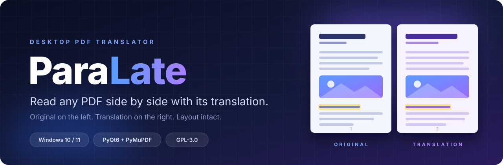
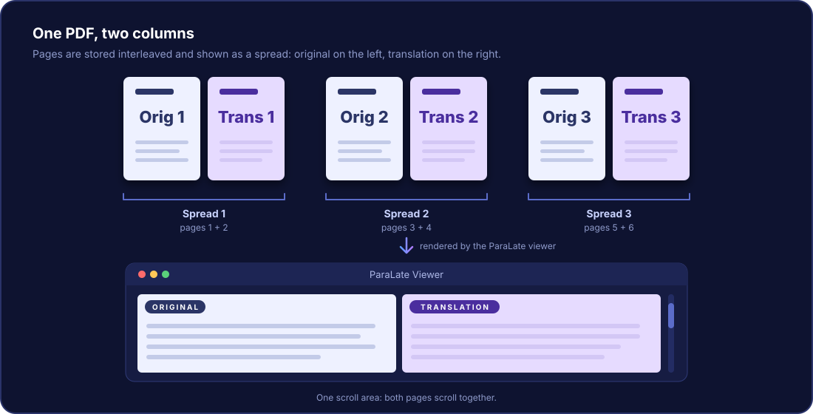
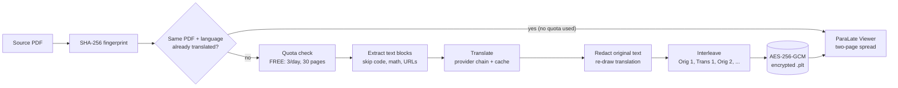

<div align="center">



<br>

<a href="https://github.com/OWNER/ParaLate/releases/latest"></a>
&nbsp;
<a href="#-quick-start"></a>
&nbsp;
<a href="https://github.com/OWNER/ParaLate/issues"></a>

<br><br>


<br><br>

<b><a href="#-install">Install</a></b> &nbsp;·&nbsp;
<b><a href="#-features">Features</a></b> &nbsp;·&nbsp;
<b><a href="#-how-it-works">How it works</a></b> &nbsp;·&nbsp;
<b><a href="#-free-vs-premium">Free vs Premium</a></b> &nbsp;·&nbsp;
<b><a href="#-configuration">Configuration</a></b> &nbsp;·&nbsp;
<b><a href="#-development">Development</a></b> &nbsp;·&nbsp;
<b><a href="#-license">License</a></b>

</div>

<br>

**ParaLate** translates a text-based PDF page by page and gives you back **one PDF** in which every original page is followed by its translation (`Orig 1, Trans 1, Orig 2, Trans 2, …`). Its built-in viewer then shows each pair as a **two-page spread**: original on the left, translation on the right, in a single scroll area.

It behaves like the *Page view → Two pages* mode of the Microsoft Edge PDF viewer, but with the translation already sitting next to the source.

> **Built for studying.** ParaLate was created to read English lecture PDFs with a Turkish translation beside them, quickly and comfortably. It works for any language pair supported by its translation providers.

<br>

## ✨ Features

<table>
  <tr>
    <td width="33%" valign="top">
      <h3>📖 True two-page spread</h3>
      <p>Original left, translation right, one shared scroll area. Zoom, fit, <kbd>Ctrl</kbd>+<kbd>F</kbd> search, clickable links, and real text selection from the PDF's own text layer.</p>
    </td>
    <td width="33%" valign="top">
      <h3>🎨 Layout-preserving pages</h3>
      <p>Text is redacted from the original page while <b>images and vector art stay</b>. The translation is written back into the same boxes with the source colors, bold and italic carried over.</p>
    </td>
    <td width="33%" valign="top">
      <h3>🔁 Resilient engine</h3>
      <p>A provider chain with retry, backoff and automatic fallback. It works <b>without any API key</b>, and gets steadier when you add your own.</p>
    </td>
  </tr>
  <tr>
    <td width="33%" valign="top">
      <h3>🔐 Encrypted library</h3>
      <p>Every translated document is stored as an AES-256-GCM encrypted <code>.plt</code> file. Reopen anything from History without translating again.</p>
    </td>
    <td width="33%" valign="top">
      <h3>⚡ Smart caching</h3>
      <p>The same PDF with the same language pair is never processed twice, and a reused result costs no daily quota. Text blocks are cached too.</p>
    </td>
    <td width="33%" valign="top">
      <h3>🧩 Open and tested</h3>
      <p>GPL-3.0 source, signed offline licensing, a JSON-based localization layer and a 95-test pytest suite covering PDF, storage, quota, licensing and GUI.</p>
    </td>
  </tr>
</table>

<details>
<summary><b>Everything else that is included</b></summary>

<br>

- **Code stays code.** Monospace and code blocks, math, bare URLs and e-mail addresses are detected and left untranslated.
- **Fails safely.** If a page cannot be rendered, ParaLate falls back to an untouched copy of the original page instead of breaking the document. A failed or cancelled job never leaves a half-written document behind, and it gives the quota back.
- **Background work.** Long jobs run on Qt worker threads, so the interface never freezes. Progress, current stage and error codes are shown.
- **History.** Every finished translation is listed with file name, language pair, page count and last-opened date. Open, delete one, or clear all.
- **Tabbed viewer.** Opening a document that is already open switches to its tab instead of loading it twice.
- **Dark UI.** A full dark theme, a first-run language chooser (Türkçe / English) and JSON-based localization (`localization/tr.json`, `localization/en.json`).
- **Safe by default.** API keys live in environment variables, `.env` or the OS keyring, are masked in logs, and are never written to the config file.
- **Rotating logs.** `logs/paralate.log` with a redaction filter.

</details>

<br>

## 📥 Install

### Windows (recommended)

1. Download **`Setup.exe`** from the [latest release](https://github.com/OWNER/ParaLate/releases/latest).
2. Run it and pick the installer language: **English, Türkçe, Русский or Français**.
3. Review and accept the license notices. The full GPL and AGPL texts are shown in their original English.
4. ParaLate installs into your user account and adds **Start menu and desktop shortcuts** plus an entry in *Apps & features*.

Uninstalling **keeps your documents and settings**. Delete the data folder yourself if you want them gone (see [Where data lives](#where-data-lives)).

> [!NOTE]
> `Setup.exe` is currently **not Authenticode-signed**, so Windows SmartScreen may show a warning. Compare the file's SHA-256 hash with the one published in the release notes before running it:
> ```powershell
> Get-FileHash .\Setup.exe -Algorithm SHA256
> ```

**Requirements:** Windows 10 or 11 (x64) and an internet connection for translating.

### Linux and from source

There is no Linux installer. You can run ParaLate from source, see [Development](#-development).

<br>

## 🚀 Quick Start

1. **Launch ParaLate.** On first run, choose the interface language.
2. **Select a PDF.** The file structure and page count are checked before anything is translated.
3. **Choose the languages.** The source language can be *Auto*.
4. **Click Translate.** You see progress, the current stage, and clear error messages if something goes wrong.
5. **Read.** The viewer opens the interleaved PDF as a two-page spread.

| In the viewer | What it does |
|---|---|
| Drag with the mouse | Select text from the real PDF text layer |
| Double-click | Select a word |
| <kbd>Ctrl</kbd>+<kbd>C</kbd> | Copy the selection |
| <kbd>Ctrl</kbd>+<kbd>F</kbd> | Search the document |
| Zoom and fit shortcuts | Scale the spread |
| Links | `http`, `https` and `mailto` links open safely |

> [!IMPORTANT]
> ParaLate reads the PDF's **real text layer**. Scanned or image-only PDFs are not supported, because there is **no OCR** and no offline AI translation.

<br>

## 💎 Free vs Premium

| | FREE | PREMIUM |
|---|:---:|:---:|
| New PDF translations | 3 per calendar day | No daily limit |
| Pages per PDF | Up to 30 | No page limit |
| Reopen saved translations offline | ❌ internet required | ✅ |
| Download the translated PDF | ❌ | ✅ |
| Re-open an already translated PDF + language pair | ✅ no quota used | ✅ |
| Upgrade prompt | When a viewer tab opens, then every 7 minutes after you dismiss it | None |
| Ad slot | Present | Hidden |

- Deleting documents or clearing History does **not** restore the daily quota.
- A job that fails or is cancelled before producing a document gives its quota back.
- Translating a *new* PDF needs an internet connection on both plans.

**Getting Premium.** Activation keys are issued manually. Contact me on [Telegram](https://t.me/NOZ_7_T) or by [e-mail](mailto:yorulmazoguzhan306@gmail.com). A key is a time-limited, digitally signed code (from 7 days to 1 year) that the app verifies **offline**.

<br>

## 🧠 How It Works

<div align="center">

</div>

<br>

Every new translation runs this pipeline on a worker thread:



<details>
<summary><b>Page rendering details</b></summary>

<br>

- **Extraction.** PyMuPDF's `get_text("dict")` provides bounding boxes, text, font size and family, bold/italic flags, color, line count and spacing, and alignment for every span. The body font is estimated from the character-weighted median font size.
- **Classification.** Blocks are labeled `HEADING`, `BODY`, `CODE`, `MATH` or `SKIP`. Only headings and body text are translated.
- **Redaction.** The original text is removed with PyMuPDF redaction configured so that **images and vector drawings are not touched**.
- **Fitting.** The translation is drawn into the original text box. If it does not fit, the font shrinks step by step (down to 6 pt), the box may grow into free neighboring space, and as a last resort the readable part is drawn and a warning is logged.
- **Fonts.** Base-14 `helv` breaks Turkish glyphs, so ParaLate uses a system TrueType font: Segoe UI on Windows, DejaVu or Liberation on Linux.
- **Annotations.** Highlights and underlines stay on the untouched original page. Style transfer to the translated text (color, bold, italic) is proportional and approximate, not word-for-word.

</details>

<details>
<summary><b>Translation engine details</b></summary>

<br>

| Constant (`app/constants.py`) | Value |
|---|---|
| `PROVIDER_ORDER` | `google → mymemory → microsoft → libretranslate` |
| `TRANSLATE_MAX_CHARS` | 3500 characters per chunk (longer text is split by sentence or section) |
| `TRANSLATE_RETRY_ATTEMPTS` | 2 extra tries on transient errors |
| `TRANSLATE_RETRY_BACKOFF` | 0.75 s base, exponential |
| `TRANSLATE_HTTP_TIMEOUT` | 20 s |

</details>

<br>

## 🔑 Configuration

ParaLate **works without any API key**: it tries the public Google Translate endpoint first and falls back to MyMemory if that is rejected. Add keys for steadier, higher-quality providers.

| # | Provider | Variables | Notes |
|:-:|---|---|---|
| 1 | **Google** | `GOOGLE_TRANSLATE_API_KEY` *(optional)* | Without a key it uses a public endpoint that can return `429` and then falls through. With a key it uses [Cloud Translation v2](https://console.cloud.google.com/apis/credentials). |
| 2 | **MyMemory** | none | Keyless fallback. Good on sentences, weaker on isolated words. |
| 3 | **Microsoft** | `MICROSOFT_TRANSLATOR_API_KEY`, `MICROSOFT_TRANSLATOR_REGION` | [Azure Translator](https://azure.microsoft.com/free/azure-ai-translator). Key and region required. |
| 4 | **LibreTranslate** | `LIBRETRANSLATE_URL`, `LIBRETRANSLATE_API_KEY` *(optional)* | Your own server or [portal.libretranslate.com](https://portal.libretranslate.com). |

```bash
cp .env.example .env      # Windows PowerShell: Copy-Item .env.example .env
```

```dotenv
GOOGLE_TRANSLATE_API_KEY=AIza...
MICROSOFT_TRANSLATOR_API_KEY=xxxxxxxx
MICROSOFT_TRANSLATOR_REGION=westeurope
LIBRETRANSLATE_URL=https://libretranslate.example.com
LIBRETRANSLATE_API_KEY=xxxxxxxx
```

Keys are read with `python-dotenv`. A real environment variable wins over `.env`, and keys can also be stored in the **OS keyring**. They are masked as `***` in logs. `.env` is git-ignored: never commit it, and never embed real keys in a build.

### Where data lives

| OS | Location |
|---|---|
| Windows | `%APPDATA%\ParaLate\` |
| Linux | `~/.local/share/paralate/` |
| Override | `PARA_LATE_DATA_DIR=/some/path` |

The folder holds `config/`, `database/` (SQLite), `documents/` (encrypted `.plt` files), `cache/`, `logs/` and `temp/` (cleaned on start and exit).

<br>

## 🧑‍💻 Development

**Requirements:** Python 3.12+.

<details open>
<summary><b>Windows (PowerShell)</b></summary>

```powershell
winget install --id Python.Python.3.12      # if Python 3.12 is not installed

git clone https://github.com/OWNER/ParaLate.git
cd ParaLate

python -m venv .venv
.venv\Scripts\Activate.ps1
pip install -r requirements-dev.txt

.venv\Scripts\python.exe main.py
```

</details>

<details>
<summary><b>Linux (Debian / Ubuntu example)</b></summary>

```bash
sudo apt install python3.12 python3.12-venv \
     libgl1 libegl1 libxkbcommon0 libdbus-1-3 fonts-dejavu

git clone https://github.com/OWNER/ParaLate.git
cd ParaLate

python3.12 -m venv .venv
source .venv/bin/activate
pip install -r requirements-dev.txt

.venv/bin/python main.py
```

On a headless machine set `QT_QPA_PLATFORM=offscreen`. Application windows stay invisible in that mode, so use it for tests only.

</details>

### Tests

```bash
QT_QPA_PLATFORM=offscreen python -m pytest      # Windows cmd: set QT_QPA_PLATFORM=offscreen
```

GUI tests run offscreen, so no display is needed.

<details>
<summary><b>What the 95 tests cover</b></summary>

<br>

| File | Tests | Focus |
|---|:-:|---|
| `test_licenses.py` | 20 | CRC fields, signature, dates, durations, clock checks |
| `test_limits.py` | 17 | Daily quota, page limit, reset and refund |
| `test_pdf.py` | 17 | Extraction, classification, rendering, redaction |
| `test_storage.py` | 14 | Document CRUD, encrypted store, cache |
| `test_translation.py` | 10 | Providers, chunking, fallback, retry, cache |
| `test_gui_smoke.py` | 6 | Offscreen windows, viewer, promo timer, setup flow |
| `test_interleave.py` | 6 | Page order, link preservation |
| `test_hashing.py` | 5 | SHA-256 and cache keys |

Counts reflect the source at the time of writing. `tools/test_premium_key_generator.py` adds 4 more tests and is run separately.

</details>

<br>

## 📦 Build the Windows Installer

```powershell
.venv\Scripts\python.exe -m pip install -r requirements-dev.txt
.venv\Scripts\python.exe scripts\build_release.py
```

The script converts `icon.png` into a multi-size `icon.ico`, builds the app with PyInstaller (`ParaLate.spec`), packs the app payload and license texts into a single `Setup.exe` (`installer/Setup.spec`), and writes the matching source snapshot and third-party license inventory. The `release` folder it produces contains exactly:

```
release/
├── Setup.exe
├── Source/                  # source snapshot + SOURCE_CODE.md
└── ThirdPartyLicenses/      # license texts + package inventory
```

Rebuild the package whenever the version, icon, spec file or dependencies change.

<details>
<summary><b>Linux build (experimental)</b></summary>

```bash
.venv/bin/python -m PyInstaller --noconfirm --windowed \
  --name ParaLate \
  --collect-all pymupdf \
  --add-data "localization:localization" \
  main.py
```

Output: `dist/ParaLate/ParaLate`. The `--add-data` separator is platform specific: `;` on Windows, `:` on Linux.

</details>

<br>

## 🧱 Project Structure

<details>
<summary><b>Show the source tree</b></summary>

```
ParaLate/
├── main.py                       # entry point
├── ParaLate.spec                 # PyInstaller spec for the app
├── requirements.txt              # runtime dependencies
├── requirements-dev.txt          # + pytest, PyInstaller
├── requirements-lock-windows.txt # pinned Windows dependency set
├── pytest.ini
├── .env.example                  # API key template
├── icon.ico / icon.png
│
├── app/                          # bootstrap and global settings
│   ├── application.py            # startup order, services, logging, first run
│   ├── config.py                 # user settings (language, first run, ...)
│   ├── constants.py              # limits, language list, viewer settings
│   ├── network.py                # online / offline detection
│   └── services.py               # AppServices: single dependency carrier
│
├── pdf/                          # PDF core
│   ├── extractor.py              # text blocks, spans, classification
│   ├── renderer.py               # font loading, wrapping, fitting
│   ├── translator_renderer.py    # redaction-based translated page
│   ├── interleaver.py            # Orig1, Trans1, Orig2, Trans2, ...
│   ├── loader.py                 # safe PDF open and error mapping
│   └── metadata.py               # metadata and PDF serialization
│
├── translation/                  # translation layer
│   ├── base.py                   # provider interface, errors, cancel
│   ├── manager.py                # chain, retry/backoff, chunking
│   ├── google.py  mymemory.py  microsoft.py  libretranslate.py
│   └── cache.py                  # SQLite translation cache
│
├── storage/                      # persistence
│   ├── paths.py                  # AppData / XDG paths
│   ├── database.py               # SQLite schema
│   ├── models.py                 # document, quota and license models
│   ├── repository.py             # CRUD API
│   └── encrypted_document.py     # .plt read/write (AES-GCM, atomic replace)
│
├── security/                     # crypto and secrets
│   ├── encryption.py             # AES-256-GCM, keyring + file master key
│   ├── hashing.py                # document fingerprint, cache key
│   └── secrets.py                # .env / keyring access, masking
│
├── licensing/                    # FREE / PREMIUM
│   ├── base.py  offline_provider.py  license_manager.py
│   ├── public_key.py             # verification key only
│   ├── issue_license.py          # issuer CLI (needs a private key you keep)
│   └── limits.py                 # QuotaService
│
├── ads/                          # ad-slot abstraction (no ad network wired)
├── workers/                      # QThread workers
│   ├── translation_worker.py     # the full translation pipeline
│   ├── pdf_worker.py             # load saved documents
│   └── license_worker.py         # activation off the GUI thread
│
├── ui/                           # PyQt6 interface (dark theme)
│   ├── home_window.py  history_widget.py  translation_window.py
│   ├── pdf_viewer.py             # ViewerWindow + SpreadCanvas
│   ├── language_dialog.py  style.py  ad_banner.py
│   └── dialogs/                  # premium_dialog.py, premium_promo.py
│
├── localization/                 # tr.json, en.json
├── installer/                    # Setup app, Setup.spec, license texts
├── scripts/                      # build_release.py
├── tools/                        # premium key generator and its docs
├── tests/                        # pytest suite
└── docs/images/                  # README artwork
```

</details>

<br>

## 🔐 Security and Privacy

> [!IMPORTANT]
> **Your document text is sent to the translation provider** you use (Google, MyMemory, Azure or LibreTranslate), because translation is online. Do not translate confidential documents through services you do not trust. A self-hosted LibreTranslate server keeps text on your own infrastructure.

- **Encrypted at rest.** Documents are stored as AES-256-GCM `.plt` files with a random 12-byte nonce per file and an authenticated header. The decrypted PDF exists only in memory for the viewer. Writes go to a temporary file first and are swapped in atomically.
- **Key handling.** The master key comes from the OS keyring, with a fallback key file in the config folder.
- **Secrets.** API keys come from environment variables, `.env` or the keyring, are masked in logs, and are never written to configuration.
- **Signed licenses.** Premium keys carry an Ed25519 signature. The app ships **only the public verification key**; the signing key stays with the issuer and is never part of the source or the installer.
- **Clock checks.** The app remembers the last date it saw and refuses a clock that moves backwards. This is a best-effort measure, not protection against someone who controls the local database and system clock.
- **Back up before wiping.** If the encryption key or the app data folder is lost, existing `.plt` documents cannot be recovered.
- **Safe links.** Only `http`, `https` and `mailto` links open from the viewer.

Found a vulnerability? Please report it privately by e-mail instead of opening a public issue.

<br>

## 🧰 Tech Stack

| Layer | Technology |
|---|---|
| Language | Python 3.12 |
| GUI | PyQt6 (QThread / signal model) |
| PDF | PyMuPDF: extraction, redaction, merging, rendering |
| Storage | SQLite (WAL, foreign keys, short-lived connections) |
| Crypto | `cryptography`: AES-256-GCM, Ed25519 |
| Secrets and config | `keyring`, `python-dotenv` |
| Networking | `requests` |
| Packaging | PyInstaller |
| Testing | pytest |

<br>

## 🚧 Known Limitations

- No OCR: the PDF must contain selectable text.
- Translating needs a network connection and a working translation service. The keyless public endpoints give **no guarantee** of speed, quality, quota or availability, and a provider may reject requests.
- Layout is rebuilt block by block. Complex columns, tables, vertical text, backgrounds and mixed fonts may not be reproduced perfectly.
- Translated text can be longer or shorter than the original, so the renderer shrinks fonts, grows boxes and, as a last resort, trims text.
- Color, bold and italic transfer is approximate. Highlight, underline and strike-through annotations are not re-attached to individual translated words.
- The ad slot is only an abstraction layer. No ad network is connected.
- The offline license cannot give cryptographic clock or revocation guarantees.
- The installer is Windows-only and is not code-signed yet.

<br>

## 🩺 Troubleshooting

| Symptom | What to try |
|---|---|
| Translation fails or is slow | Check `<data folder>/logs/paralate.log` for `provider` and `fallback` entries, verify your `.env` keys, or add a provider key to avoid public-endpoint rate limits. |
| Windows warns about `Setup.exe` | The build is unsigned. Verify the SHA-256 hash from the release notes. |
| GUI does not start on Linux over SSH | Use a real display. `QT_QPA_PLATFORM=offscreen` hides windows and is meant for tests. |
| Turkish characters look wrong | A suitable system font is missing. Install `fonts-dejavu` or `fonts-liberation` on Linux. |

<br>

## 📜 License

ParaLate's original source code is © 2026 Oğuzhan YORULMAZ / NOZ-7 Software and is released under the **[GPL-3.0-only](./LICENSE)** license.

The copyright holder may separately offer a commercial or closed-source license **for ParaLate's own code only**. To discuss it, write to [yorulmazoguzhan306@gmail.com](mailto:yorulmazoguzhan306@gmail.com). That grant does not cover third-party software.

The Windows build bundles third-party components under their own licenses:

| Component | License |
|---|---|
| PyQt6 | GPL-3.0 (Riverbank also sells a separate commercial license) |
| PyMuPDF / MuPDF | AGPL-3.0 or an Artifex commercial license |
| Qt libraries | LGPL-3.0 and other component-specific licenses |
| cryptography | Apache-2.0 or BSD-3-Clause |
| requests | Apache-2.0 |
| python-dotenv | BSD-3-Clause |

An open-source distribution built with these dependencies must satisfy their terms, in particular **AGPL-3.0**. Distributing a **closed-source** build additionally requires the third-party commercial licenses, including those for PyQt6 and PyMuPDF. Each release ships the matching source snapshot, dependency pins, license texts and a package inventory. See [`installer/THIRD_PARTY_NOTICES.md`](./installer/THIRD_PARTY_NOTICES.md).

*This summary is not legal advice.*

<br>

## 🤝 Contributing

Bug reports, ideas and pull requests are welcome.

1. Open an [issue](https://github.com/OWNER/ParaLate/issues) to discuss larger changes first.
2. Fork the repository and create a feature branch.
3. Run `python -m pytest` and make sure the suite passes.
4. Open a pull request that explains what changed and why.

Contributions are accepted under the project's GPL-3.0-only license. Never commit `.env` files, signing keys or real API keys.

<br>

## 💬 Contact

<div align="center">

<a href="mailto:yorulmazoguzhan306@gmail.com"></a>
&nbsp;
<a href="https://t.me/NOZ_7_T"></a>

<br><br>

**If ParaLate saves you time, a ⭐ on the repository helps others find it.**

<sub>Made by <b>NOZ-7 Software</b> · Oğuzhan YORULMAZ · © 2026</sub>

<br>

<a href="#readme">↑ Back to top</a>

</div>
